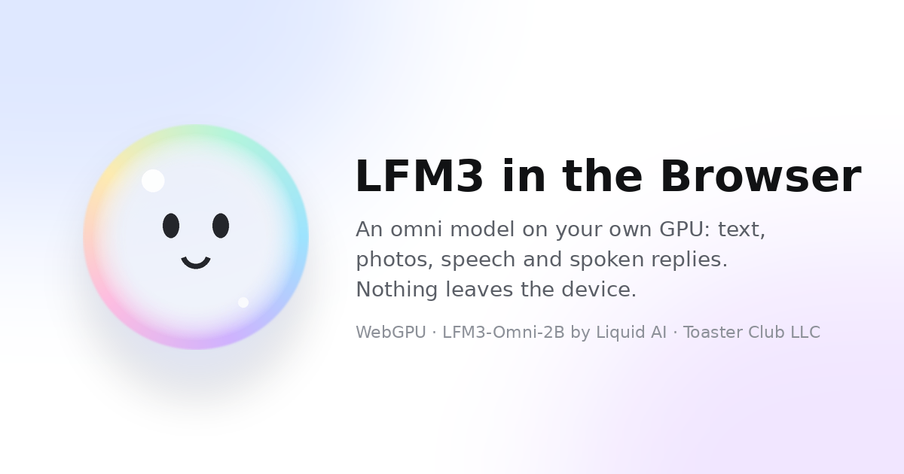

# LFM3 in the Browser

**Liquid AI's [LFM3-Omni-2B](https://huggingface.co/LiquidAI/LFM3-Omni-2B) running on your own GPU, in a web page.**
It reads text, photos and speech, and answers in text or out loud. There is no server-side inference and no
install: the page streams the weights into WebGPU, and nothing you type, say or show leaves the device. It works
on an iPhone in Safari 26 or later.

**Try it:** <https://lfm.toasterclub.com>



This is a **reference implementation**: the simplest complete way to use LFM3-Omni-2B directly inside a website
or web app. Copy one folder to any static host and load the model in one call. There is no server code, no build
step and there are no dependencies.

Implementation by **Mage / Toaster Club LLC**. The model is by **Liquid AI** and is used under its
[LFM Open License v1.0](LICENSE-LFM.txt) (see [Terms of use](#terms-of-use)). This is an independent project, not
affiliated with Liquid AI.

| Start here | |
| --- | --- |
| Using the app, installing it, privacy, troubleshooting | [USER.md](USER.md) |
| AI coding agents: setup, repo map, rules, checks | [AGENTS.md](AGENTS.md) |
| Using the engine in your own page | [docs/API.md](docs/API.md) and [`public/examples/chat.html`](public/examples/chat.html) |
| How it works; the weights; how it was tested | [docs/ARCHITECTURE.md](docs/ARCHITECTURE.md), [docs/WEIGHTS.md](docs/WEIGHTS.md), [docs/TESTING.md](docs/TESTING.md) |

## What it does

- **Chat.** You type, and the reply streams back as it is written.
- **Push to talk.** Hold the mic button and speak, then let go. Your speech goes into the model while you are still
  talking, so the spoken answer starts right after you let go.
- **Live.** The camera fills the screen, and you hold the bubble to talk. The picture from the moment you start
  talking goes in with your words.
- **Photos.** Ask about a picture you attach.
- **Spoken replies.** Answers come back as speech and text together, in the model's own voice.
- **Memory.** When a chat ends, the assistant reads what you said, spoken or typed, and keeps facts and standing
  instructions on the device. The next chat starts already knowing them. Nothing is retrieved per message and the
  weights never change.
- **Your own instructions.** Settings takes an optional system prompt.
- **Smoke test.** Settings runs every workflow once on your device and measures it. That covers text (time to
  the first token, prefill and decode tokens per second), a photo, a spoken reply, speech recognition, and a
  push-to-talk turn with a camera picture. Copy, share or save the results.
- **Installable.** Add it to the iPhone home screen. The weights stay in the browser's storage after the first
  load.

## How it works, in one paragraph

Every layer of the model is hand-written as **WGSL compute shaders** with no ML framework and no WebGPU extensions,
so the same code runs on Safari for iOS, Chrome, Edge and Safari on desktop, and Dawn in Node.js. The language model
uses GPTQ 4-bit weights; the image encoder, speech encoder, speech decoder and voice codec use 4- or 8-bit
weights. Decoding is GPU-driven: the sampler writes the next token on the GPU, so 8 to 16 tokens run per submit
without a CPU round trip. The weights are served as lossless PNG byte containers in content-addressed folders, so
any static host or CDN can carry them and they can be cached forever. See
[docs/ARCHITECTURE.md](docs/ARCHITECTURE.md) for the details.

## Deploy your own

The site is just the static files in `public/`, about 1.3 GB including all five weight sets.

**Cloudflare Workers (static assets, free tier is enough).**
1. Fork this repository.
2. In Cloudflare, go to **Workers & Pages → Create → Import a repository**, pick your fork, and keep the defaults.
   The deploy command is `npx wrangler deploy`.

Every push to `main` then redeploys, at `https://<project>.<your-subdomain>.workers.dev`; add your own domain under the Worker's **Settings → Domains & Routes**. From a terminal instead:

```bash
npm ci
```

```bash
npx wrangler deploy
```

**Any static host.** Upload `public/` as it is. Serve `.js` as JavaScript, and give `weights/*` a long cache
lifetime, as `public/_headers` does on Cloudflare. WebGPU, the camera and the microphone need HTTPS or `localhost`.

**Run it locally:**

```bash
npx wrangler dev
```

Or, with Python only:

```bash
python3 tools/serve.py --root public --port 8080
```

Then open <http://localhost:8787> (wrangler) or <http://localhost:8080> in Chrome, Edge or Safari.

## Use the engine in your own page

Copy `public/engine/`, `public/weights/`, `public/weights.js` and the two `public/lfm3-tokenizer-*` files into your
site, then:

```js
import { loadLFM3 } from "./engine/loader.js";

const { chat } = await loadLFM3({ onProgress: (p) => console.log(`${p.got} / ${p.total} bytes`) });
const { reply } = await chat.send("Hello!", { onText: (t) => console.log(t) });
```

`loadLFM3()` does the whole loading job in one call:
- it opens WebGPU;
- it streams the language model into the GPU;
- it keeps a copy in the browser's IndexedDB, so later visits load from the device and an interrupted download
  resumes;
- it loads the tokenizer and starts a chat.

[`public/examples/chat.html`](public/examples/chat.html) is a complete page built on it. `loadVision()`,
`loadAudio()` and `loadSpeech()` add photos, speech input and spoken answers. `public/engine/index.js` exports the
whole engine from one module. The engine is plain ES modules with no dependencies; see [docs/API.md](docs/API.md).

## Checked against the original model

Each part was compared with LiquidAI/LFM3-Omni-2B in PyTorch on the same inputs. The engine ran on an NVIDIA A40
through Dawn, Chrome's WebGPU implementation, in Node.js. The raw numbers are in [`results/`](results/), and
[docs/TESTING.md](docs/TESTING.md) explains how to rerun them.

| Part | Result |
| --- | --- |
| Language model, GPTQ 4-bit | Held-out perplexity 12.73, against 12.62 for the original bf16 (+0.85%). Plain 4-bit rounding gives 13.05. |
| Language model speed (A40) | Prefill 306 tokens/s, decode 130 tokens/s; 0.93 GB of weights. |
| Image encoder, 8-bit | Its description of a test picture matches PyTorch for all 48 of 48 tokens. 768 patches encode in 0.4 s. |
| Speech encoder | The log-mel front end matches the reference to 0.00013, and a LibriSpeech clip transcribes word for word. 5.9 s of speech encodes in 30 ms. |
| Spoken replies | The text matches a deterministic PyTorch run. The 8-bit codec reaches 33.6 dB SNR against PyTorch's audio. 46.5 speech frames per second is 3.7× real time, and the model transcribes our speech back exactly. |
| Push to talk | A turn streamed in while "speaking" gives exactly the same answer as the whole clip: 24 of 24 text tokens and 89 of 89 speech frames, and the follow-up turn too. The first audio comes 164 ms after letting go, against 389 ms without streaming. |
| Memory from speech | The model heard its own spoken "My sister's name is Rosa and I live in Lisbon." word for word and learned both facts. A new chat answered "Your sister's name is Rosa and you live in Lisbon." |

On a phone, speed depends on its GPU, and the app shows the real numbers under every reply.

### Real numbers from your device

Open the site, load the model, then **Settings → Smoke test → Run the smoke test**. It checks and measures each
workflow on your GPU with the same inputs everywhere, so results compare across devices:

| Row | Checks | Measures |
| --- | --- | --- |
| Text | "What is the capital of France?" is answered "Paris" | time to the first token; prefill tok/s over a 587-token prompt; decode tok/s over 128 new tokens |
| Photo | a drawn red circle is called red | image tokens and encode time; prefill tok/s; time to the first token |
| Spoken reply | the model speaks a short introduction | time to the first sound; speech frames per second (12.5 is real time) |
| Speech in | that speech, heard back by the speech encoder and the model's own ASR, matches its text | speed against real time; share of words heard |
| Push to talk + camera | the same speech streamed in at speaking pace, with a camera picture, gets a spoken answer | time from letting go to the first sound; tokens taken in while speaking |

**Copy results** gives a short text for a post or an issue, and **Save JSON** gives every number. Nothing is
sent anywhere by the test itself. To publish your device's numbers, post the copied text in an issue.

## Repository layout

```
public/              the site: deploy this folder
  index.html app.js    the app
  engine/              the engine: WebGPU + WGSL, plain ES modules (docs/API.md)
    loader.js            the happy path: loadLFM3(), loadVision(), loadAudio(), loadSpeech()
    index.js             the whole engine in one import
  examples/chat.html   a minimal page that uses the engine
  weights.js           the weight sets' tensor lists and part URLs
  weights/<set-id>/    the model's weights as PNG parts, with chunks.json (sha256 of every part)
  lfm3-tokenizer-*     the tokenizer
  licenses/            the licenses and notices the site serves
tools/               export the weights, pack them, regenerate icons; references and tests (docs/WEIGHTS.md)
results/             measured results (docs/TESTING.md)
docs/                architecture, API, weights, testing
AGENTS.md            for AI coding agents: setup, map, rules
USER.md              for people: using it, privacy, troubleshooting, terms
```

## Credits

- **LFM3 in the Browser:** implementation by Mage / Toaster Club LLC. This covers the WebGPU engine and its WGSL
  shaders, the app, the quantized weight sets and the tools.
- **LFM3-Omni-2B:** Liquid AI, Inc. That includes the model, its weights, the tokenizer, the chat format and the
  Liquid voice codec. See the [model card](https://huggingface.co/LiquidAI/LFM3-Omni-2B).

## Terms of use

**The model.** LFM3-Omni-2B, its weights and its tokenizer are by Liquid AI, Inc., licensed under the
[LFM Open License v1.0](LICENSE-LFM.txt). Everything derived from them here (`public/weights/`,
`public/lfm3-tokenizer-*`) is under the same license. In short, and the license text governs:

- **You may** use, modify and redistribute the model, commercially or not, within the limits below.
- **If you redistribute it** (and hosting this site counts, since visitors download the weights), give recipients
  a copy of the license. Mark files you changed as changed, and keep the attribution notices and the
  [NOTICE](NOTICE). This site serves both under `licenses/`.
- **Commercial use is licensed only below US$10,000,000 in annual revenue** (Section 5). Organizations at or above
  that need a separate agreement with Liquid AI. Qualified non-profits are exempt for non-commercial or research
  use.
- **Trademarks** (Section 7): Liquid AI's names may only be used to describe where the model comes from.
- **Patents** (Section 3): patent litigation over the work ends the patent license it grants.
- **No warranty, no liability** (Sections 8–9). The license **terminates** if its terms are broken (Section 11).

**This project's code** (the engine, its WGSL shaders, the app and the tools) is under the
[Apache License 2.0](LICENSE), copyright 2026 Toaster Club LLC.

We quantized, reordered and repacked the weights; [NOTICE](NOTICE) says exactly how. LFM, LFM3 and Liquid AI are
names of Liquid AI, Inc., used here only to say where the model comes from. This project is not affiliated with,
sponsored by or endorsed by Liquid AI.

If you use this work, please cite it ([CITATION.cff](CITATION.cff)) and Liquid AI's model.
